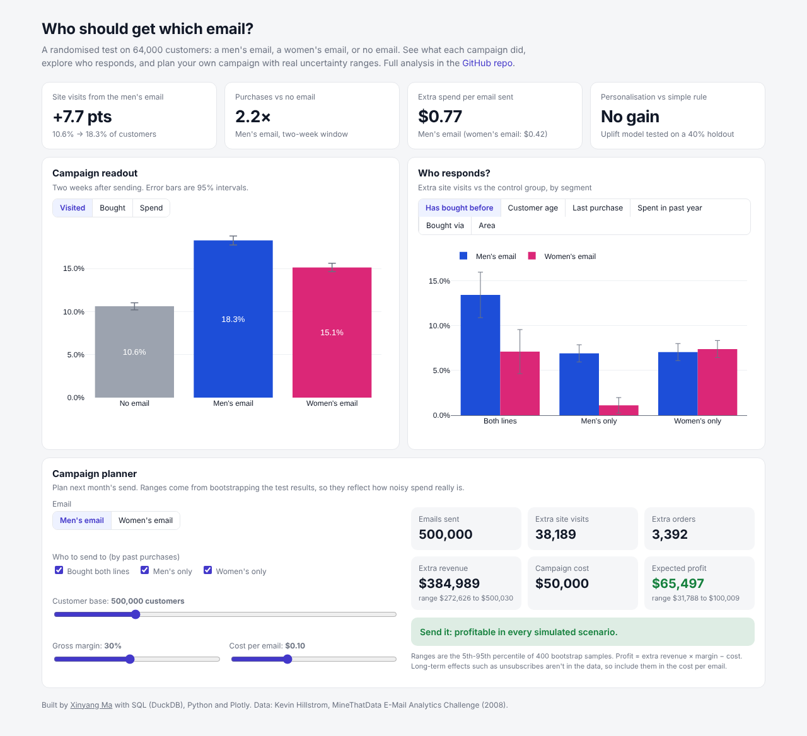
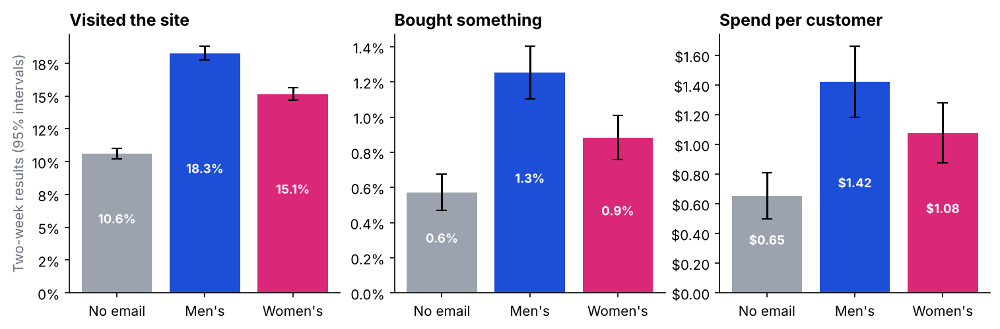
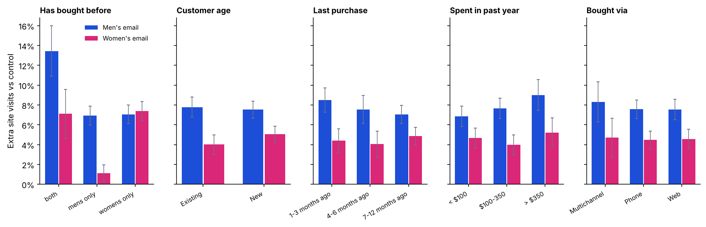
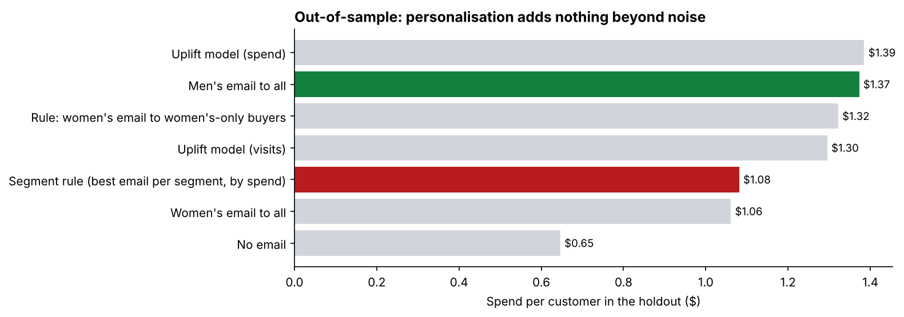
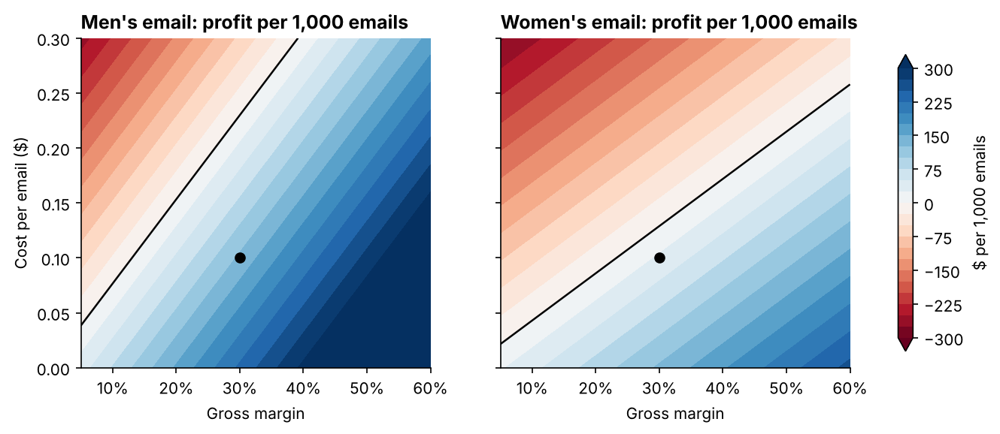

# Who should get which email? Campaign analytics on a 64,000-customer A/B test

A retailer randomly sent 64,000 customers a **men's merchandise email**, a **women's merchandise email**, or **no email**, then tracked visits, purchases and spend for two weeks. This project does what a CRM or lifecycle marketing team does with a test like that: read out the results, find who responds, test whether personalisation pays, and build the business case for next month's campaign.

**[Open the interactive dashboard](https://hakowxy.github.io/email-campaign-analytics/)** · **[Read the full analysis](notebooks/analysis.ipynb)** · **[SQL readout](sql/campaign_readout.sql)**

[](https://hakowxy.github.io/email-campaign-analytics/)

The dashboard includes a **campaign planner**: pick the email, the target segments, the size of the base, the margin and the cost per email. It returns expected extra orders, revenue and profit, with uncertainty ranges from bootstrapping the test.

## Key findings

**1. Both emails worked, and the men's email worked better.**

| | Men's email | Women's email |
|---|---|---|
| Site visits | **+7.7 pts** (10.6% → 18.3%) | +4.5 pts |
| Purchases | **2.2×** the control rate | 1.5× |
| Extra spend per email | **+$0.77** (95% CI $0.49-$1.06) | +$0.42 ($0.17-$0.68) |



**2. The women's email barely works on men's-only buyers** (+1.1 pts of visits vs +6.9 for the men's email). Customers who've bought both lines respond the most (+13 pts), so they're the first to target on a limited budget.



**3. Personalisation doesn't pay at this scale.** I compared seven targeting policies on a 40% holdout using off-policy evaluation, including two T-learner uplift models and segment rules. **"Send everyone the men's email" performed as well as the uplift models**, and segment rules built on average spend overfit and did clearly worse. The simple rule wins.



**4. The business case is solid for the men's email and marginal for the women's.** At a 30% margin and $0.10 per email, the men's email makes about **$130 profit per 1,000 emails** and breaks even at a 13% margin. The women's email makes about $29, with a one-in-four chance of a loss. For a 500,000-customer monthly send, I'd plan on the pessimistic end of the revenue range (about $268k rather than the $383k average).



## Methods

- **Randomisation check**: standardised mean differences across arms are all under 0.01.
- **Readout in SQL (DuckDB)**: lifts, relative lifts and Welch confidence intervals ([`sql/campaign_readout.sql`](sql/campaign_readout.sql)).
- **Segment analysis**: lift with confidence intervals for six customer dimensions.
- **Uplift modelling**: a T-learner with gradient boosting, plus off-policy evaluation of seven targeting policies on a holdout.
- **Business case**: bootstrapped profit distributions, a break-even map across margin and cost, and a monthly planning scenario.

## Tableau

[`data/tableau/campaign_summary.csv`](data/tableau/campaign_summary.csv) is a ready-made extract (segment × arm with customers, visits, orders and revenue) for building the same readout in Tableau Public.

## Run it yourself

```bash
pip install -r requirements.txt
python scripts/build_notebook.py
jupyter nbconvert --to notebook --execute --inplace notebooks/analysis.ipynb
python scripts/build_dashboard_data.py
```

## Source

Kevin Hillstrom, *MineThatData E-Mail Analytics and Data Mining Challenge* (2008): 64,000 customers who purchased in the previous 12 months, randomised into three groups in equal shares.

---

Made by [Xinyang Ma](https://github.com/hakowxy) · [LinkedIn](https://www.linkedin.com/in/xinyang-m-122844288/)
